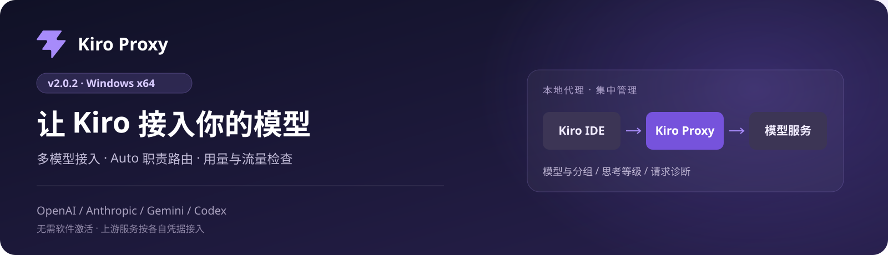
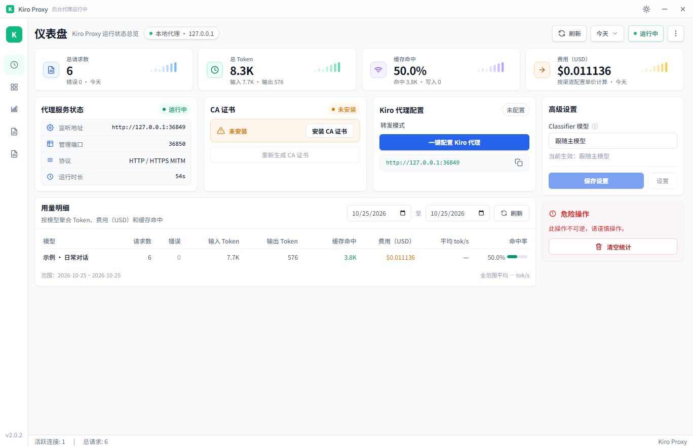
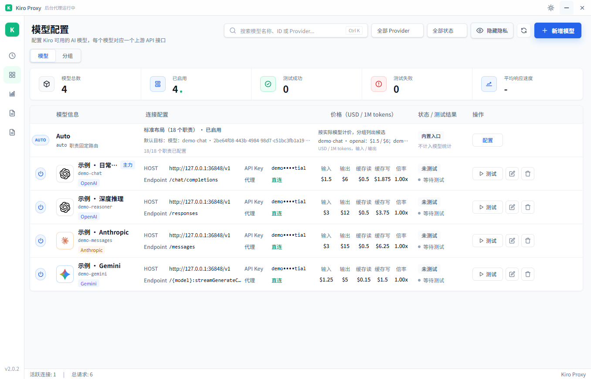
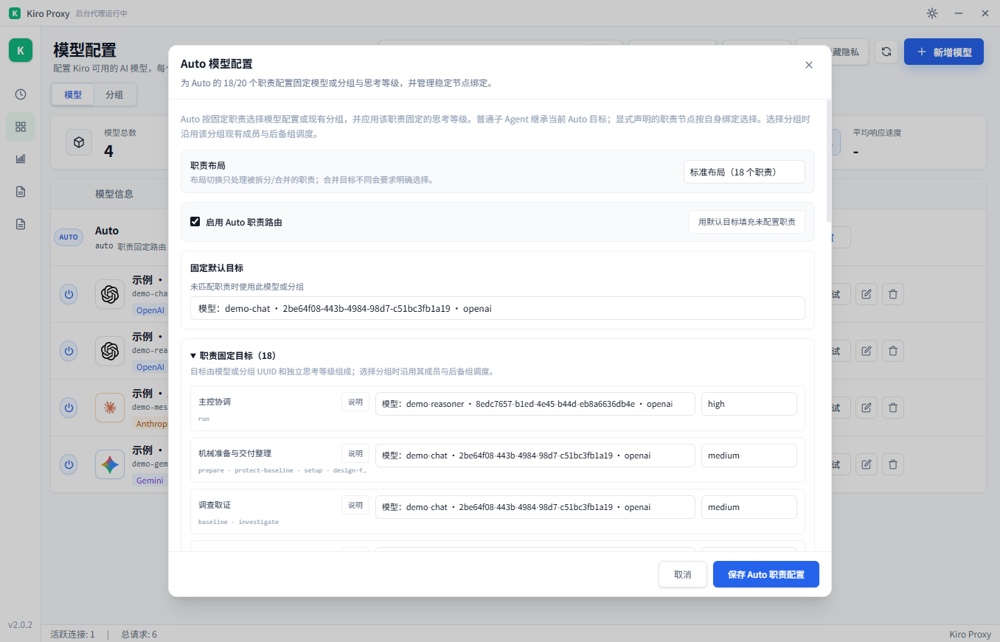
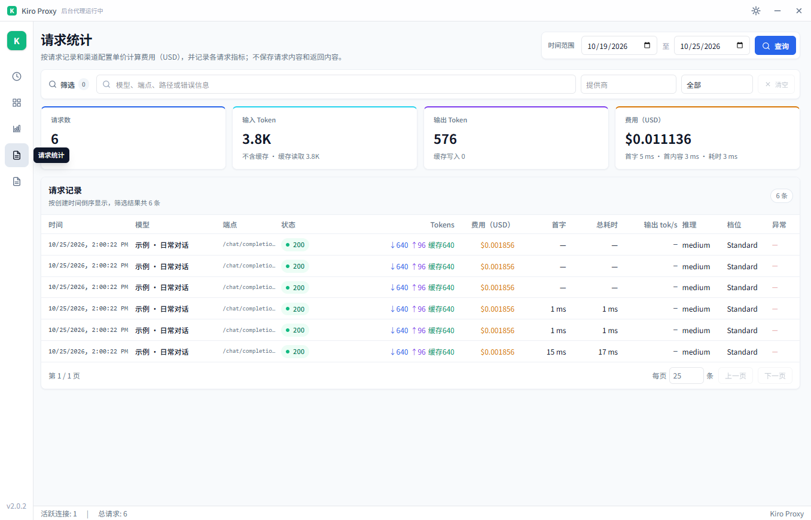
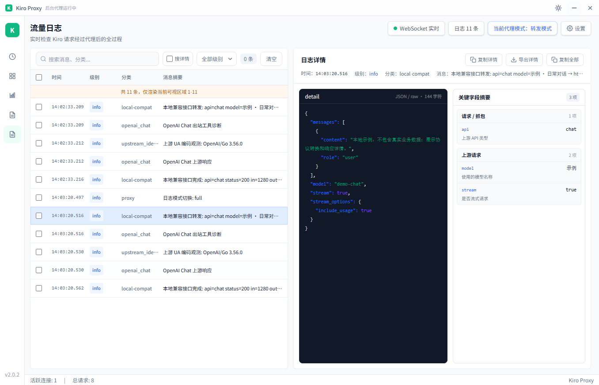

# Kiro Proxy v2.0.2



**在 Kiro 中接入自己的模型，把模型配置、Auto 路由、用量与请求排查放到同一个本地面板。**

v2.0.2 提供 Windows x64 桌面发行包，并移除软件激活要求。无需机器码登记或连接授权服务器；上游模型仍按各服务要求提供 API Key 或 OAuth 凭据。

| 版本 | 平台 | 分发方式 |
| :--- | :--- | :--- |
| **v2.0.2** | **Windows x64** | ZIP 解压运行 · 未签名 · 需要 WebView2 Runtime |

这一版可以用来：接入不同模型协议、配置 Auto 职责与思考等级、组织候选模型和后备组，以及查看 Token、缓存、费用和实时日志。下面分别展示这些已有能力；“本次更新”只列 v2.0.2 的实际变化。

## 本次更新

- **移除激活限制**：Kiro 模型转发、本地兼容 API、Typesafe 分类、管理面板与流量日志不再检查软件激活状态。上游 API Key 和 Codex OAuth 仍按各服务要求配置。
- **整理项目结构**：移除未使用模板、授权后台和旧独立抓包前端，保留主程序内的流量检查器；统一当前架构与特性文档入口。

## 下载

| 平台 | 安装包 | 说明 |
| :--- | :--- | :--- |
| **Windows x64** | **[下载 ZIP · 6.8 MiB](https://github.com/tuifeisec/Kiro-Proxy/releases/download/v2.0.2/kiro-proxy-v2.0.2-windows-amd64-unsigned.zip)** | 解压运行；需要 [WebView2 Runtime](https://developer.microsoft.com/microsoft-edge/webview2/) |
| macOS · Apple Silicon / Intel | 待补齐 | 本次没有 Mac 安装包 |

Windows 包未进行 Authenticode 签名，系统可能显示安全提示。发行包可直接从下方附件下载。下方 “Source code” 是源码压缩包，运行程序请选择 Windows ZIP。

## 功能与界面

以下为 **v2.0.2 Windows x64 发布包的实际截图**。模型配置、请求和金额均为隔离环境演示数据，使用本地模拟上游，不代表真实服务测试、性能或账单。

### 1. 代理状态与用量，打开首页就能看到

仪表盘汇总请求数、输入输出 Token、缓存命中率和费用，并提供 CA 证书与 Kiro 代理配置入口。无需切换多个页面，就能先确认代理运行状态和用量变化。



*图 1 · 仪表盘。演示实例未安装系统 CA、未修改 Kiro 代理；数据来自本地兼容 API 的模拟请求。*

### 2. 多模型接入与候选分组

支持 OpenAI Chat Completions / Responses、Anthropic Messages、Gemini，以及 Codex OAuth。每个模型可独立配置端点、价格和思考等级；分组支持候选优先级、成员并发上限和后备组，按配置的调度规则选择模型。



*图 2 · 模型管理。四条配置展示不同协议端点；模型 ID 和价格均为示例，未接入真实供应商。*

### 3. Auto 职责路由：给不同工作分配不同模型

支持标准 18 职责与细分 20 职责布局，为主控协调、调查取证、技术设计、代码实施等职责分别设置模型或分组与思考等级，也可维护节点规则和固定 default 目标。

同一原生 continuation 保持模型选择稳定。节点信息来自异步观察，缺少可靠证据时使用已配置 default；不能保证每个节点首轮都按职责精准选模。



*图 3 · 主控协调使用示例推理模型与 high，其他演示职责使用另一模型与 medium。配置界面直接呈现职责与目标的对应关系。*

### 4. 请求统计：看清 Token、缓存与费用构成

按日期、模型、提供商和状态筛选请求，查看普通输入、输出、缓存读写、费用、首字与总耗时。USD 费用按本地配置的单价估算，不等同于 Kiro 或上游服务的官方账单。



*图 4 · 6 次本地模拟请求的记录，展示缓存读取与费用拆分；不构成模型性能或成本承诺。*

### 5. 流量检查器：从实时日志追到请求详情

按关键词与日志级别筛选，选择一条记录查看 JSON 详情和字段摘要，支持复制与导出。默认摘要模式减少正文留存；排查时可启用详细日志，正文可能包含敏感信息，应按实际需要使用。



*图 5 · 已标注的本地示例请求，展示转换后的模型、消息和流式参数，不含真实会话或凭据。*

## 安装与使用

1. 完整解压 ZIP 到可写目录，运行 `kiro-proxy.exe`。
2. 在“模型配置”中添加上游地址、模型和凭据，保存后点击“测试”。
3. 在首页安装 CA 证书。先保存 Kiro 中未完成的工作，再点击“一键配置 Kiro 代理”；该操作会自动重启 Kiro。
4. 在 Kiro 中选择已配置的模型并发起请求。使用 Auto 前，请先配置有效策略及 default 目标。

关闭窗口后程序继续在后台运行；停止服务请从系统托盘选择“退出”。

**更新前请退出旧程序，备份数据库、`certs/` 与自定义配置。** Windows 数据路径取决于启动工作目录；旧库迁移后请勿与旧版程序混用。完整步骤与常见问题见 [Windows 使用指南](https://github.com/tuifeisec/Kiro-Proxy/blob/main/docs/windows-guide.md)。

[项目说明](https://github.com/tuifeisec/Kiro-Proxy#readme) · [当前架构](https://github.com/tuifeisec/Kiro-Proxy/blob/main/docs/architecture.md) · [SHA256 校验文件](https://github.com/tuifeisec/Kiro-Proxy/releases/download/v2.0.2/kiro-proxy-v2.0.2-windows-amd64-unsigned.zip.sha256) · [构建清单](https://github.com/tuifeisec/Kiro-Proxy/releases/download/v2.0.2/windows-amd64-manifest.json)

<details>
<summary>文件校验与验证范围</summary>

压缩包 SHA256：

```text
bf96d3ba192185823f5c1c89ac55af537c845a90bc64ada2e9fc5774418c3b39
```

可执行文件 SHA256：

```text
0aaa0c2c57b2c8fb6f7b2d30610f9f6ce91b2666cb70ede6599ed430c2016c47
```

构建源码提交：[5684805](https://github.com/tuifeisec/Kiro-Proxy/commit/5684805eab0997e587c56a2e2223cfee252fc55d)，构建时工作区无源码修改。后续说明文档更新不改变此包的构建身份。

已完成本机 Windows 原生桌面构建、受 Git 管理的 Go 包串行回归，以及打包程序的无窗口启动、版本与提交身份、内嵌前端、日志接口和 WebSocket 检查。Node 测试 21 项通过，2 项因缺少历史桥接编译产物而跳过。桌面 GUI 人工交互未单独验收。

</details>
