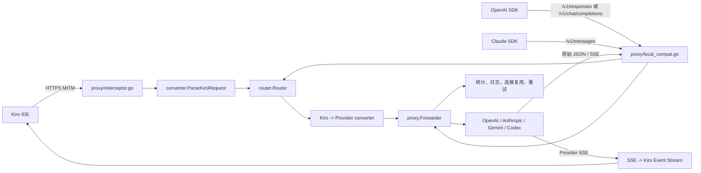

# OpenAI / Claude SDK 兼容架构

> 更新时间：2026-07-22
> 实际接入、配置和测试从 [sdk-integration-guide.md](sdk-integration-guide.md) 开始；本文只记录架构判断和模块边界。当前总架构见 [architecture.md](architecture.md)。

## 1. 架构结论

Kiro Proxy 适合接入 OpenAI 和 Claude SDK 生态，接入方式是对客户端提供兼容 HTTP API：

- 官方 SDK 位于调用方和契约测试侧。
- Go 数据面继续使用现有 `Forwarder`、自定义 `http.Client` 和原始 SSE 透传。
- 运行时不使用 `openai-go` 或 Anthropic Go SDK 重写公共转发链。
- 第一阶段只做同协议直通，不混入 OpenAI/Claude 跨协议转换。

SDK 是调用方，Kiro Proxy 是兼容网关。

## 2. 系统边界

项目由一个本地代理程序提供服务；无需软件激活或授权控制面。

1. 根目录桌面代理程序
   - MITM 端口默认 `18081`。
   - Web UI、管理 API、SDK 兼容 API 端口默认 `18082`。
   - SQLite 保存模型、设置、统计和 Responses continuation 状态。

原授权后台、机器码和版本哈希白名单已移除。上游 API Key、OAuth 和本地访问边界保持既有语义。

## 3. 数据调用链



关键代码：

| 模块 | 当前职责 | 代码位置 |
| --- | --- | --- |
| 服务组合 | 注册 MITM、UI/API 和三个兼容路由 | `proxy/server.go:111` |
| Kiro 入口 | 拦截、识别协议和选择路由 | `proxy/interceptor.go:62` |
| Kiro 解析 | 生成内部会话结构 | `converter/kiro_parse.go:16` |
| 请求转换 | 生成各 Provider 请求 | `proxy/forwarder_request.go:38` |
| 公共转发 | 连接、代理、重试、鉴权和 trace | `proxy/forwarder.go:79` |
| Kiro 响应 | Provider SSE 转 AWS Event Stream | `proxy/forwarder_stream.go:17` |
| SDK 入口 | 同协议 JSON/SSE 直通 | `proxy/local_compat.go:43` |
| 精确路由 | 按 Name 或 ModelID 匹配 | `router/router.go:117` |
| 模型配置 | Provider、端点、密钥和价格 | `store/model.go:27` |

## 4. 已有 SDK 兼容能力

| 客户端方法 | HTTP 路由 | 当前状态 |
| --- | --- | --- |
| `openai.responses.create()` | `POST /v1/responses` | 基础可用 |
| `openai.chat.completions.create()` | `POST /v1/chat/completions` | 基础可用 |
| `anthropic.messages.create()` | `POST /v1/messages` | 基础可用 |

当前实现：

- 使用 `Router.ResolveExact`，未知模型不会回退到第一条路由。
- 只替换请求体中的上游 `model`。当前实现会重编码整个顶层对象，数组顺序和未知字段通常保留，但尚未达到字节级无损。
- OpenAI 请求只进入 OpenAI/Codex 路由。
- Claude 请求只进入 Anthropic 路由。
- SSE 字节流直接回传，同时旁路解析 usage。
- 两个入口复用模型密钥、上游代理、连接池、重试和统计。

因此当前不是从零接 SDK，而是需要把基础兼容实现补成稳定协议契约。

## 5. 现有 Go 缓存基线

项目中的“缓存”不是单一功能，当前由五层机制共同组成：

| 层级 | 代码位置 | 作用 | 是否计入 cache Token |
| --- | --- | --- | --- |
| 稳定前缀重排 | `converter/cache_optimize.go` | 把易变内容移到历史前缀之后 | 是，由上游返回命中量 |
| 工具转换缓存 | `converter/tool_cache.go` | 避免重复转换约 300KB 的 Kiro 工具定义 | 否，仅节省本机 CPU/分配 |
| Provider 缓存标记 | `converter/kiro_to_*.go` | 写入 cache key、breakpoint 或稳定 system | 是 |
| Responses continuation | `converter/responses_continuation.go`、`store/responses_session.go` | 用 `previous_response_id` 和 delta input 减少全量重发 | 单独判断，不等同于 cache read |
| Usage 采集 | `converter/stream_*.go`、`proxy/local_compat.go` | 从上游响应读取 cache read/write | 是，以上游字段为准 |

### 稳定前缀规则

`ParseKiroRequest` 从 Kiro 请求中取得 `conversationId`、agent mode、continuation ID、system、历史消息、当前消息和工具定义。当前转换只拆出一类动态内容：

- system 中从 `Here is the last user message:\n` 开始的动态尾部。

当前用户消息中的 `<EnvironmentContext>...</EnvironmentContext>` 保持在原始 user content 中，避免同一消息从 current 进入 history 后改变结构。

各 Provider 的最终顺序是：

| Provider | 稳定区 | 当前轮动态区 |
| --- | --- | --- |
| OpenAI Chat | static system、历史对话、稳定排序的 tools | 当前 tool result、system 动态尾部、原始 current user |
| OpenAI Responses | 首条 developer static system、历史 input、稳定排序的 tools | 当前 function output、system 动态尾部、原始 current user |
| Anthropic | static system breakpoint、稳定排序的 tools 最后一个 breakpoint、历史消息 | 当前 tool result、system 动态尾部、原始 current user |
| Gemini | static systemInstruction、历史 contents、稳定排序的 tools | 当前 function response、system 动态尾部、原始 current user |

OpenAI Chat 和 Responses 使用 `PromptAffinityKey` 写入 `prompt_cache_key` 和 `user`，当前值保持 Kiro `conversationId`。上游会话 Header 也保持原 `conversationId`，Classifier 使用固定的 `kiro-classifier` 会话 ID。Responses SQLite 状态另用 `ContinuationStateKey`，因此同一会话中的 `vibe` 与 context/subagent 分支不会互相覆盖。

Anthropic 同时使用三种 breakpoint：静态 system block、最后一个 tool、顶层 `cache_control` 自动滚动点。转发层当前固定写入 `anthropic-version: 2023-06-01` 和 `anthropic-beta: prompt-caching-2024-07-31`。

### 工具稳定性

Kiro 工具定义先 canonical JSON，再按内容计算 16 字符 hash；实际 Provider tools 再按稳定名称排序。本地转换结果缓存 10 分钟，最多 100 组。

这层缓存只优化本机转换。SDK 兼容入口不进入 `converter/`，因此 SDK 调用方必须保证 tools 数组顺序和 schema 序列化稳定。兼容入口不应重排 SDK tools，否则会改变 JSON 语义直通契约。

### Responses continuation

自动 continuation 只作用于 Kiro 转换链，并且必须同时满足：

- 模型开启 `EnableContinuation`。
- 使用 Responses API。
- 不是 Classifier。
- Kiro `conversationId` 非空。
- 上次完整 input 是本次完整 input 的逐项字节前缀。

只有收到明确完成且无错误的 Responses 流，才把 `response_id` 和完整 input 快照写入 SQLite。上游用可识别的 4xx 拒绝续传时，代理删除旧状态并回退全量请求；状态在启动时清理超过 7 天的记录。

SDK 入口不执行这套自动 continuation。SDK 客户端传入的 `previous_response_id` 会原样转发，由调用方管理。

### Usage 口径

当前 Kiro 流转换器的统计能力：

- OpenAI Chat：读取 `prompt_tokens_details.cached_tokens` 和兼容上游的 hit/miss 字段；cache write 为 0。
- OpenAI Responses：读取 `input_tokens_details.cached_tokens` 和兼容上游的 hit/miss 字段；cache write 为 0。
- Anthropic：读取 `cache_read_input_tokens`、`cache_creation_input_tokens`。
- Gemini：读取 `cachedContentTokenCount`；cache write 为 0。

SDK 入口还支持从普通 JSON/SSE 中合并上述 OpenAI、Responses 和 Anthropic 基础字段。统计只记录上游真实返回值，不推导或伪造 cache write。

### 原始 Kiro 抓包对照

`jilu/kiro_traffic.log` 是 Kiro passthrough 原始流量，不是当前转换器生成的上游请求。对其中生成请求重新统计得到：

- 75 条生成请求，全部使用同一个 `conversationId` 和 `claude-haiku-4.5`。
- 60 条 `agentMode=vibe`，15 条 `agentMode=context-gatherer`。
- 8 个非空 `agentContinuationId`，另有 1 条请求该字段为空。
- 62 条请求的当前 `content` 为空，并携带 tool results，说明主要流量是同一任务内的工具续轮。
- 日志记录的原始 request detail 为 58,968 至 518,727 字节，中位数 314,777 字节，P90 为 454,323 字节。
- 73 条 request detail 被日志器截断到 65,536 字节；只有 `000769` 和 `000780` 可完整解析。因此大部分结论来自稳定出现在截断前的顶层字段，不能把被截断 body 当作完整 JSON fixture。

55 条未截断的 AWS Event Stream 响应包含 `contextUsagePercentage` 和 `meteringEvent.usage`，没有 Provider 原始的 input/cache read/cache creation 字段；其余 20 条生成响应被截断。因此这份抓包能证明请求前缀存在问题，但不能直接计算真实缓存命中率。

#### Context-gatherer 首轮角色漂移

完整请求 `000769` 的 history 为空，当前 `content` 是一个 20,494 字符的 bootstrap prompt。完整请求 `000780` 把完全相同的字符串放入 `history[0].userInputMessage.content`，两者逐字符一致。

当前 `ParseKiroRequest` 只在 `history[0]` 调用 `looksLikeSystemPrompt`：

- `000769` 首轮：整段内容保留为当前 `user`。
- `000780` 第二轮：同一内容被识别为 system，并转换为 OpenAI `system/developer` 或 Anthropic `system`。

同一前缀的角色和协议位置发生变化，首轮建立的 Provider 前缀无法成为第二轮请求的严格前缀。Responses continuation 的逐项 `bytes.Equal` 也会失败，只能再次发送全量 input。

修复时必须让 bootstrap prompt 在首轮和后续 history 中走同一套归一化，但不能简单把首轮整段提升为 system：`000769` 没有 history，当前消息没有 tool result；清空 `CurrentContent` 后，Anthropic 会生成空 `messages`，Gemini 会生成空 `contents`，协议兼容性反而下降。

本次 P0 已利用顶层 `agentMode`：`context-gatherer` 的 bootstrap 在首轮 current 和后续 `history[0]` 都保持为一个原始 user 消息，不再被 `looksLikeSystemPrompt` 的 sub-agent marker 提升为 system。这样不改变 Kiro 原始角色，也能使 `000769` 的首条 user 成为 `000780` 的首条历史 user。

首版同时不要拆 snapshot。现有 `optimizeCurrentContentForCache` 只处理当前消息中的 EnvironmentContext；如果首轮拆成多个消息而第二轮 history 保持一个消息，Responses 的逐项前缀仍不相等。

后续若要让不同 context-gatherer 分支共享更长的静态前缀，两条解析路径必须使用同一个结构化边界：

```text
稳定 system：bootstrap 开头 -> <session_start_snapshot> 之前
分支动态内容：session snapshot + 实际任务 + EnvironmentContext
```

在 `000769` 中，`<session_start_snapshot>` 位于字符 11,417，前面约 466 行是稳定规则和 agent 指令；当前 `optimizeSystemForCache` 只识别 `Here is the last user message:`，不会识别这个边界。这项拆分应作为 P1，并要求首轮 current 与后续 history 使用同一个规范化函数后再启用。

#### Current/history 转换不对称

修复前的 EnvironmentContext 优化也存在独立问题。抓包的 13 条非空 current 请求中，有 8 条 current 明确包含 EnvironmentContext。当时转换器只拆当前消息，不拆下一轮出现的同一条历史消息：

```text
第 N 轮 OpenAI/Responses：user(EnvironmentContext) + user(question)
第 N+1 轮历史：           user(question + EnvironmentContext)
```

Anthropic 会从当前轮的两个 content blocks 变回下一轮的单个 string；Gemini 也只对 current 重排 parts。内容没有丢失，但序列化结构不再是 append-only，因此 Provider 最长前缀会在上一轮 current 处中断，Responses continuation 更不可能把第 N 轮完整 input 识别为第 N+1 轮前缀。

本次 P0 已停止重排 EnvironmentContext，保持 Kiro 原始 user content 为一个整体，并用跨轮逐项字节测试覆盖 OpenAI、Responses、Anthropic 和 Gemini。若以后确实需要拆分，必须对 current 和所有 history user 调用同一个纯规范化函数。

现有 `TestResponses_PrefixStability` 也没有覆盖 continuation 的真实条件：它只比较两轮的第一个 developer item 和一个公共历史 item，没有断言第一轮的完整 `input` 等于第二轮 `input` 的前缀。`ApplyResponsesContinuation` 在运行时检查的是全部旧 items 的 `bytes.Equal`，测试标准必须与这里一致。

`Here is the last user message:` 动态尾部移动同样服务于 Provider 最长公共前缀，而不保证 Responses append-only。两种目标要分开验收：Provider prompt cache 看真实 cache read Token；continuation 看完整 input 的严格逐项前缀。当前缀重排与 append-only 冲突时，continuation 应明确回退全量，不能用“静态第一项一致”宣称续传可命中。

#### 上下文压缩边界

抓包中 `000678` 是自动摘要请求，current 以 `[SYSTEM NOTE: This is an automated summarization request due to context limit]` 开头，请求体为 518,727 字节，`agentMode=vibe` 且 `agentContinuationId` 为空。`000689` 是压缩后恢复请求，current 为 `[SYSTEM NOTE: context compacted - resume from the summary and recent messages above.]`，请求体降到 259,805 字节，并恢复原 vibe task continuation ID。

这不是独立 agent mode，而是普通 vibe 会话主动重写 history。Responses continuation 在 `000689` 必须识别前缀变化并全量发送一次，以压缩后的 input 覆盖旧状态；从 `000699` 开始再基于新 input 继续 delta。普通 vibe 的 `ContinuationStateKey` 因此必须保持 `conversationId`，不能跟随摘要请求中为空、压缩后又恢复的 `agentContinuationId` 变化。回归测试应同时覆盖“压缩时拒绝旧 continuation”和“压缩后下一轮命中新 continuation”。

#### Continuation 状态碰撞

原始请求的 `agentMode` 位于 `conversationState` 外层，当前 `KiroRequest` 没有接收它；`AgentContinuationID` 虽已反序列化，也没有进入 `ParsedConversation`。Responses continuation 的 SQLite 主键因此只使用裸 `conversationId`。

抓包顺序是 `vibe` 请求到 `000768`，随后 `000769` 至 `000978` 为同一 context-gatherer 分支，`000990` 又回到 `vibe`。若模型启用 Responses continuation，context-gatherer 成功响应会覆盖主会话的单条 SQLite 状态；回到 `vibe` 后前缀不同，只能全量发送并再次覆盖。这是源码和抓包共同支持的状态碰撞，但由于抓包没有 cache Token，不能量化命中损失。

这里必须区分三种键，不能统一成一个 `CacheScopeID`：

| 键 | 职责 | 推荐值 |
| --- | --- | --- |
| `PromptAffinityKey` | `prompt_cache_key`/Provider 前缀路由亲和 | 先保持 `conversationId` |
| `ContinuationStateKey` | SQLite 中唯一的 previous response 链 | `vibe` 用 `conversationId`；context/subagent 用 `conversationId + agentMode + agentContinuationId` |
| `UpstreamSessionID` | 四种非标准会话 Header | 先按实际中转站契约确认，不与前两者强制绑定 |

共享 `prompt_cache_key` 只说明请求倾向进入同一缓存路由，并不能从源码推出“不同分支会覆盖 Provider 缓存”。反过来，贸然给每个 subagent 更换 affinity key 还可能降低公共稳定前缀的复用。因此当前有直接证据需要分支隔离的是 SQLite continuation 状态，不是所有缓存字段。

普通 `vibe` 的 `ContinuationStateKey` 不直接使用 `agentContinuationId`：抓包中它会随新任务变化，而主历史仍在同一个 conversation 中追加。非 `vibe` 分支使用带长度前缀的 `conversationId + agentMode + agentContinuationId`；continuation ID 为空时仍与主 `vibe` 状态键隔离。

### 对 SDK 接入结论的影响

SDK 兼容入口与 Kiro MITM 转换链是两条入口。接入官方 SDK 可以让新业务调用方主动维持稳定 messages、tools、cache key 和 `previous_response_id`，但不会修复 Kiro role 漂移、current/history 不对称或 continuation 状态碰撞。实施顺序应先把这些 Kiro P0 纳入回归基线，再做 SDK 契约补全；否则 SDK 测试通过也不能代表 Kiro IDE 的缓存已经改善。

## 6. 运行时不引入厂商 SDK 的原因

### 公共能力重复

现有 `Forwarder` 已承担：

- 自定义 Transport、HTTP/2 和连接池。
- 单模型上游代理。
- 长请求超时。
- DNS、连接、TLS、首字节 trace。
- 失败重试、日志和请求统计。
- OpenAI、Anthropic、Gemini、Codex 鉴权。

厂商 SDK 也会封装 HTTP Client、重试、超时和错误，两者叠加会形成两套请求生命周期。

### 结构无损透传更容易跟随协议变化

兼容入口只应修改 `model`。上游新增 JSON 字段时，代理通常无需同步增加完整请求结构体。实现时仍需使用 `json.RawMessage` 或等价 JSON AST 保留未知值，不能通过 `map[string]interface{}` 把大整数转成 `float64` 后再编码。

### 原始 SSE 是核心数据

Kiro 链路需要读取 Provider 的原始事件，再转换成 AWS Event Stream。厂商 SDK 的高级流对象会先消费 SSE，增加二次编码和事件语义丢失风险。

### Provider 不止两个

当前还有 Gemini 和 Codex。Codex 使用 ChatGPT OAuth 和 `/codex/responses`，并非标准 OpenAI API，官方 OpenAI SDK不能替代 `codex/client.go`。

## 7. 推荐代码边界

保留 `proxy` 作为数据面包，扩展时按职责拆分 `local_compat.go`：

```text
proxy/
  local_compat.go             # 授权、路由和公共编排
  local_compat_openai.go      # OpenAI 路由、错误、模型列表
  local_compat_anthropic.go   # Claude 路由、错误、count_tokens
  local_compat_headers.go     # 入站头白名单与上游头策略
  local_compat_stream.go      # SSE 透传与 usage 旁路采集
  local_compat_usage.go       # 两种协议的 usage 解析
```

边界规则：

- `converter/` 只负责 Kiro 与 Provider 的格式转换。
- SDK 同协议直通不进入 `converter/`。
- `router/` 只负责模型选择。
- `Forwarder` 继续拥有网络、上游鉴权、重试和 trace。
- 厂商错误结构、功能 Header 和扩展端点属于兼容入口。

## 8. 本地鉴权

当前兼容接口校验软件授权，但没有把 SDK 传入的 `Authorization` 或 `x-api-key` 当作本地网关凭证。

仅 loopback 模式下可以接受占位 key；局域网模式下必须避免局域网客户端直接使用代理中保存的上游密钥。

| 访问模式 | 本地 SDK 鉴权 |
| --- | --- |
| 仅本机 | 允许固定占位 key，例如 `local-proxy` |
| 局域网 | 强制校验独立的本地 API Token |

设计要求：

- SDK 的 `apiKey` 用于访问 Kiro Proxy。
- `store.Model.APIKey` 只用于 Kiro Proxy 访问上游。
- 客户端 Authorization 不直接转发给上游。
- 新增 `local_api_token_hash`，数据库只保存哈希。
- Token 为空时不开放 SDK 局域网访问。

## 9. 请求头策略

`Forwarder.doRequest` 当前创建新请求并写入 Provider Header。SDK 兼容入口需要额外传递协议功能头，但不应全量转发客户端 Header。

OpenAI 白名单：

- `OpenAI-Beta`
- `Idempotency-Key`
- `x-client-request-id`

Claude 白名单：

- `anthropic-version`
- `anthropic-beta`
- `anthropic-user-profile-id`

本地扩展：

- `x-kiro-session-id` 由兼容入口消费，用于生成现有的会话关联 Header，不作为厂商 Header 原样透传。

始终由模型配置覆盖：

- `Authorization`
- `x-api-key`
- Host、Content-Length 和 hop-by-hop headers

建议让 `sendWithRetry` 接收过滤后的 `http.Header`，由 `doRequest` 在设置 Provider 鉴权后合并功能头。

## 10. 错误协议

当前入口共用 `kiro_proxy_error`。正式兼容应按厂商返回：

OpenAI：

```json
{
  "error": {
    "message": "no route for model",
    "type": "invalid_request_error",
    "param": "model",
    "code": "model_not_found"
  }
}
```

Claude：

```json
{
  "type": "error",
  "error": {
    "type": "invalid_request_error",
    "message": "no route for model"
  },
  "request_id": "req_local_xxx"
}
```

HTTP 状态码保持真实，不使用成功响应掩盖错误。

## 11. 流式响应原则

SDK 入口继续原始 SSE 透传，usage 解析只做旁路观察：

- 不修改事件顺序，不合并 delta。
- 不重新生成事件 ID。
- 每次写入后 Flush。
- 客户端取消时取消上游 Context。
- usage 解析异常只影响统计，并留下明确记录。

Codex 非流式 Responses 聚合是特例。聚合器需要保留最终 `response` 对象中的工具、reasoning 和其他 output items，不能只拼接 `output_text`。

## 12. Usage 与缓存统计

现有解析覆盖普通输入输出、OpenAI cache read、Claude cache read 和 cache creation。后续只补充有真实上游 fixture 或官方 schema 依据的字段：

- 新 Responses 最终事件中的 usage。
- Provider server tools 的独立 usage。

流式事件继续采用累计值取最大值策略，避免重复相加。OpenAI 或 Responses 上游没有返回 cache write 时保持 0，不根据输入量推算。

## 13. 模型配置

OpenAI：

```text
Name: gpt-5.6
ModelID: gpt-5.6
Provider: openai
BaseURL: https://api.openai.com
Endpoint: /v1/responses
```

Claude：

```text
Name: claude-opus-4-8
ModelID: claude-opus-4-8
Provider: anthropic
BaseURL: https://api.anthropic.com
Endpoint: /v1/messages
```

SDK 请求的 `model` 优先匹配 `Name`，再匹配 `ModelID`。对外应使用稳定、唯一的 `Name`，允许多个渠道复用同一个上游 ModelID。

## 14. 跨协议转换边界

第一阶段只支持：

- OpenAI SDK 到 OpenAI/Codex。
- Claude SDK 到 Anthropic。

OpenAI 请求转 Claude、Claude 请求转 OpenAI 应独立立项，因为需要完整处理 system、tool call、tool result、thinking、structured output、stop reason 和 SSE 事件语义。该能力不应混入同协议直通代码。
